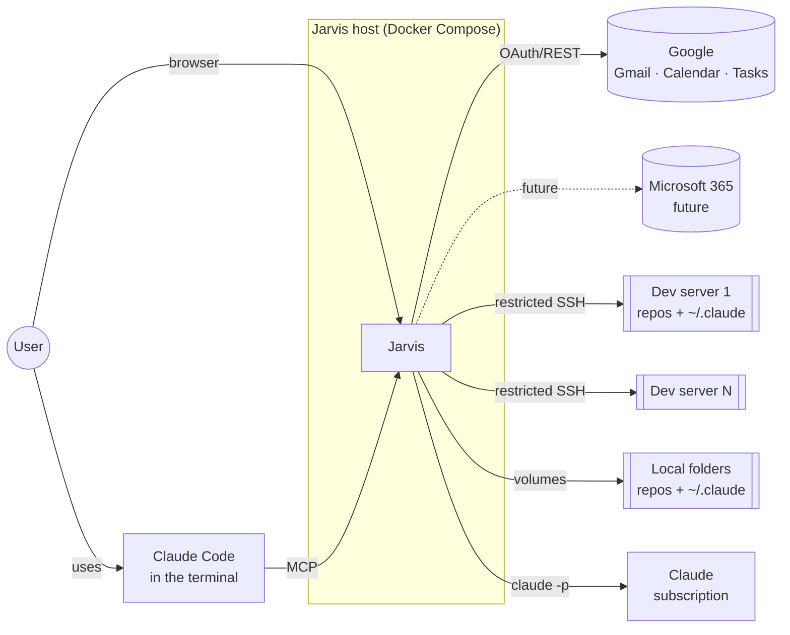
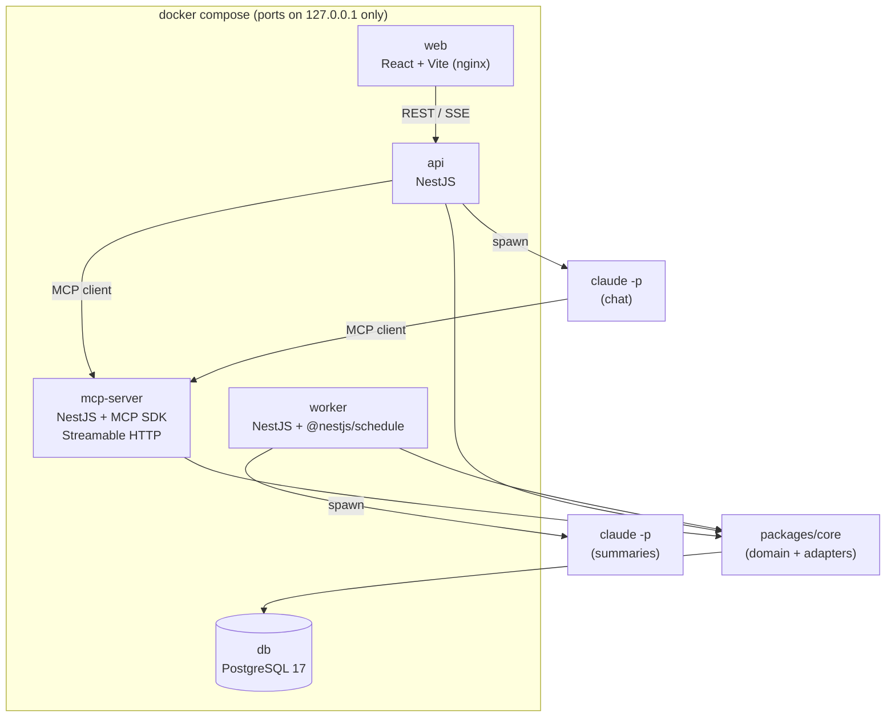
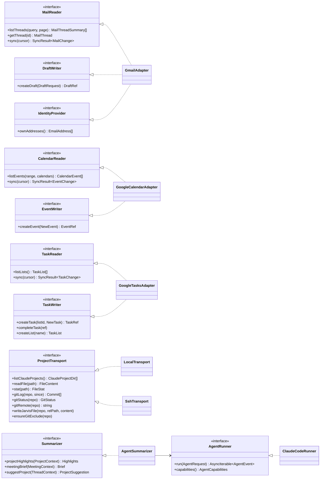
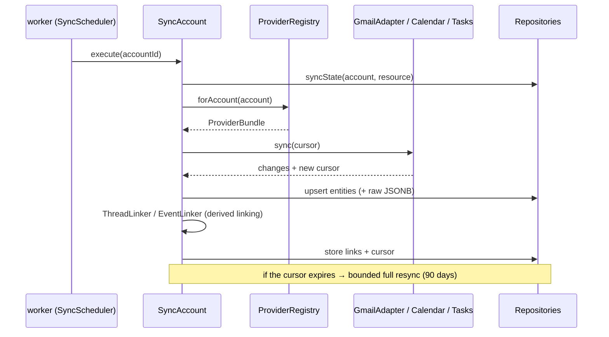
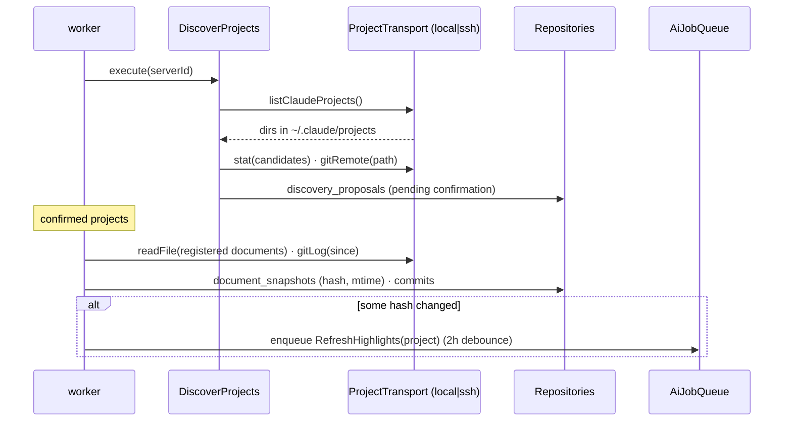
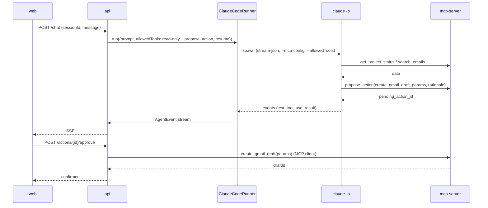
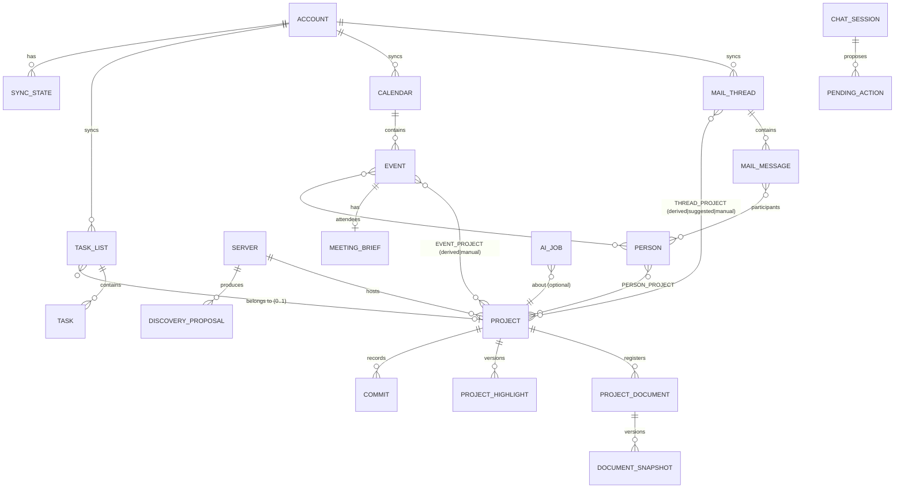

# Jarvis Architecture

> Living document. It describes **how Jarvis is built**. The **why** and the scope decisions are in
> [`superpowers/specs/2026-11-23-jarvis-design.md`](superpowers/specs/2026-11-23-jarvis-design.md).

## 1. Context view

Jarvis is a personal assistant that runs locally in Docker. It integrates email, calendar and task providers, reads the state of development projects on several servers and uses an AI agent (Claude Code, with the user's subscription) to summarize, answer questions and propose actions.



## 2. Containers (Docker Compose)



| Container | Role | Exposes |
|---|---|---|
| `web` | React dashboard. No business logic. | `127.0.0.1:3000` |
| `api` | Dashboard backend: reads/writes through an **MCP client**, admin endpoints (registry, linking, approvals), chat orchestration (`AgentRunner`), SSE streaming. | `127.0.0.1:3001` |
| `mcp-server` | **The agents' only gateway** to data and actions. Domain tools on top of `core`. | `127.0.0.1:3002` (bearer token) |
| `worker` | Jobs: sync, project discovery, snapshots, task mirror, AI queue. | — |
| `db` | Persistence. | internal network only |

`api` and `worker` ship the Claude Code CLI; the subscription token arrives as a Docker secret.

## 3. Layers and dependencies (ports and adapters)

```mermaid
flowchart TB
  subgraph apps["apps/* (delivery layer · NestJS)"]
    A1[api<br/>controllers · SSE]
    A2[mcp-server<br/>MCP tools]
    A3[worker<br/>jobs]
  end
  subgraph app["packages/core/application (use cases)"]
    UC[GetDailyBriefing · BlockFocusTime · CreateDraft<br/>SyncAccount · DiscoverProjects · RefreshHighlights<br/>LinkEntity · ProposeAction · ApproveAction …]
  end
  subgraph dom["packages/core/domain (pure TS)"]
    E[Entities and value objects<br/>MailThread · CalendarEvent · Task · Project · Person · Account]
    S[Domain services<br/>FreeSlotFinder · ThreadLinker · EmailCleaner · PriorityRules]
    P[Ports (interfaces)]
  end
  subgraph adapters["packages/adapters-* (infrastructure)"]
    AG[adapters-google]
    AT[adapters-transport<br/>local · ssh]
    AA[adapters-agent<br/>claude-code]
    AP[adapters-persistence<br/>drizzle/postgres]
  end
  apps --> app
  app --> dom
  adapters -- implement --> P
  apps -. composition (DI) .-> adapters
```

**Dependency rule:** arrows point inwards. `domain` imports nothing external; `application` only imports `domain`; adapters import `domain` (to implement ports) and their SDKs; apps are the **composition root** that wires everything together with NestJS dependency injection. A lint rule (`dependency-cruiser`) enforces this.

## 4. Main ports



In addition, one repository port per aggregate (`AccountRepository`, `ProjectRepository`, `MailRepository`, `EventRepository`, `TaskRepository`, `PersonRepository`, `HighlightRepository`, `PendingActionRepository`, `SyncStateRepository`), implemented with Drizzle.

### Registries and factories (the O in SOLID)


Provider differences are queried through **capabilities** (`ProviderCapabilities`: `threads`, `replyHeaders`, `sendAsAliases`, `taskLists`, `freeBusy`…), never with `instanceof`.

## 5. Key flows

### 5.1 Syncing an account



### 5.2 Project discovery and snapshots



### 5.3 Chat with action approval



### 5.4 Background AI queue

`AiJobQueue` (Postgres table + processor in `worker`): concurrency 1, per-key debounce (`highlights:<project>`), configurable daily cap, time window for meeting briefs (07:30) and catch-up of missed runs on startup. Each run records duration, reason and result.

### 5.5 Task mirror

`TaskChange` in a list linked to a project → `MirrorTasks(project)` → Markdown render → `ProjectTransport.ensureGitExclude` + `writeJarvisFile(".jarvis/tasks.md")`.

## 6. Data model



Conventions: internal UUID IDs; external IDs unique as `(account_id, external_id)`; a `raw jsonb` column with the provider's original response; `created_at`/`updated_at` everywhere; links store `origin` and `created_at` for historical analytics.

## 7. Repository layout

```
jarvis/
├─ apps/
│  ├─ api/            NestJS: chat, actions, registry, links, read-models modules
│  ├─ mcp-server/     NestJS + MCP SDK: one provider per tool group
│  ├─ worker/         NestJS + schedule: sync, discovery, snapshots, mirror, ai-queue
│  └─ web/            React + Vite
├─ packages/
│  ├─ core/
│  │  ├─ domain/       entities, value objects, services, ports
│  │  └─ application/  use cases
│  ├─ adapters-google/
│  ├─ adapters-transport/   local, ssh
│  ├─ adapters-agent/       claude-code
│  ├─ adapters-persistence/ drizzle (schema, migrations, repositories)
│  ├─ contracts/            per-port contract tests (reusable by adapters)
│  └─ shared/               DTOs and Zod schemas (api ↔ web ↔ mcp)
├─ agent/             agent instructions, skills and permissions (versioned)
├─ remote/            jarvis-remote (SSH forced command) + installer
├─ docker/            Dockerfiles
├─ docs/              architecture, specs, plans
├─ secrets/           (git-ignored) OAuth, tokens, keys
├─ jarvis.config.example.yaml
└─ docker-compose.yml
```

## 8. Security (technical summary)

| Risk | Mitigation |
|---|---|
| Unwanted email sending | There is no send port or tool; the `gmail.compose` scope is only used for drafts. |
| Uncontrolled agent actions | In chat, only read tools + `propose_action`; the real execution is triggered by `api` after approval. |
| Prompt injection from emails/documents | External content is delimited and marked as untrusted; the agent has no Bash or file editing. |
| Arbitrary execution on servers | `SshTransport` only with named operations + `jarvis-remote` as forced command in `authorized_keys`. |
| Improper writes to repos | Only `writeJarvisFile` under `.jarvis/`; excluded via `.git/info/exclude`; never commits. |
| Secrets | Docker secrets from `secrets/` (git-ignored); OAuth tokens 0600; nothing sensitive in logs. |
| Network exposure | Ports on `127.0.0.1`; MCP with bearer token. |

## 9. How to extend

**New provider (e.g. Microsoft 365)**
1. Create `packages/adapters-microsoft` with classes that implement the needed ports (`MailReader`, `DraftWriter`, …) and declare their `capabilities()`.
2. Implement `MicrosoftProviderFactory` and `MicrosoftOAuthFlow`.
3. Make the `packages/contracts` suite pass for each port.
4. Register the factory in `ProviderRegistry` (providers Nest module). Domain and use cases do not change.

**New transport** (e.g. a remote agent over HTTP): implement `ProjectTransport`, pass the contracts, register it in `TransportRegistry`, add the `kind` to the config schema.

**New agent**: implement `AgentRunner` (`AgentEvent` streaming, sessions, allowed MCP tools) and register it in `AgentRegistry`. `AgentSummarizer` works on top of any `AgentRunner`.
