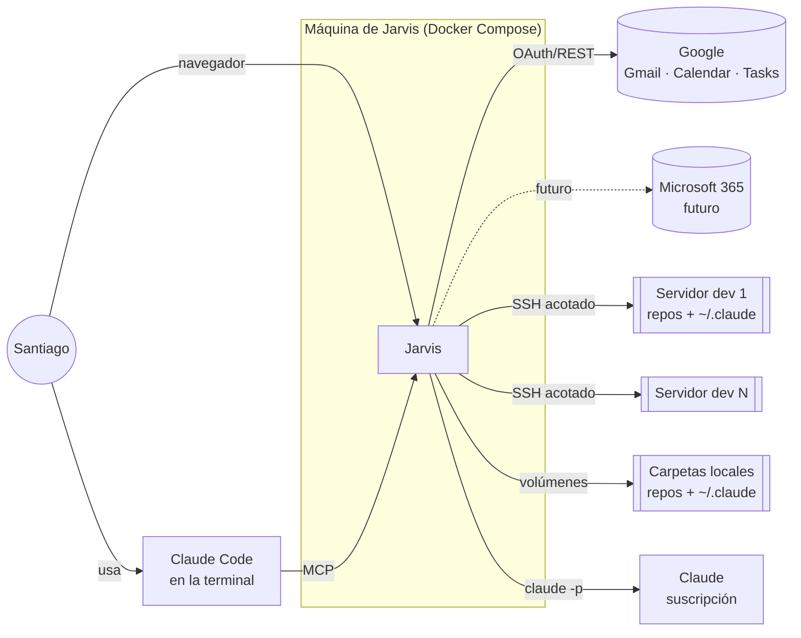
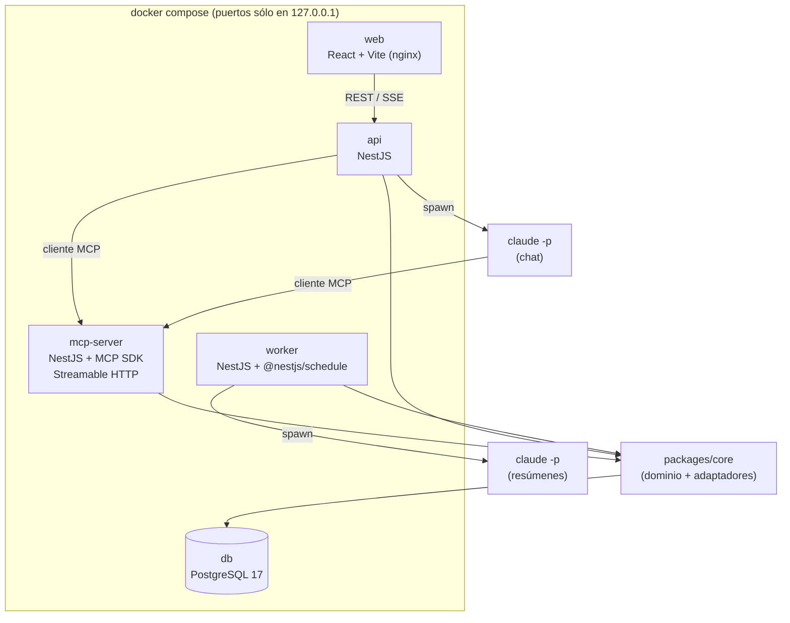
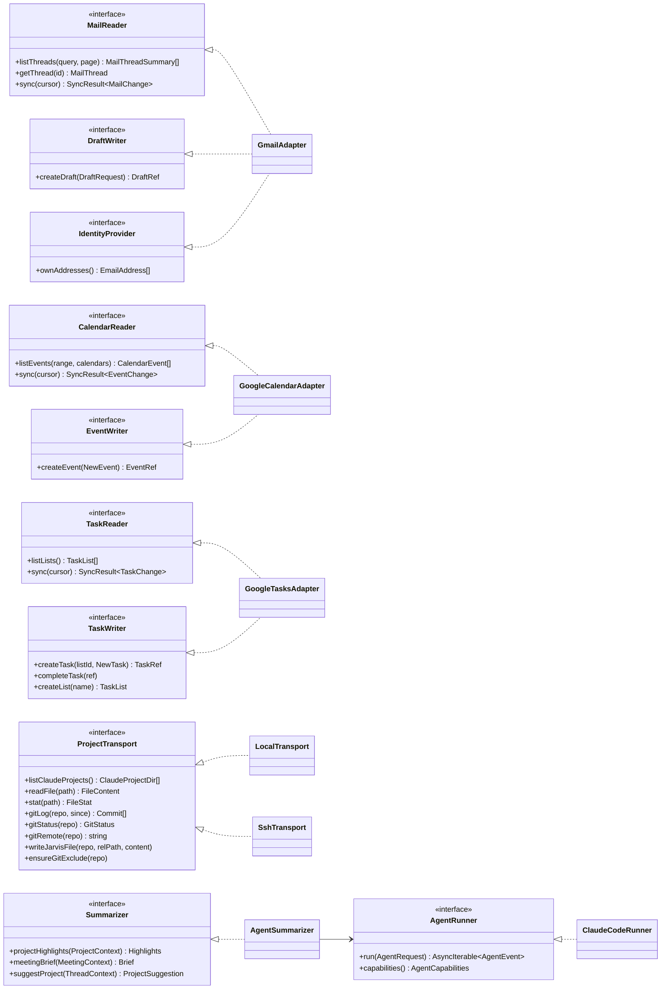
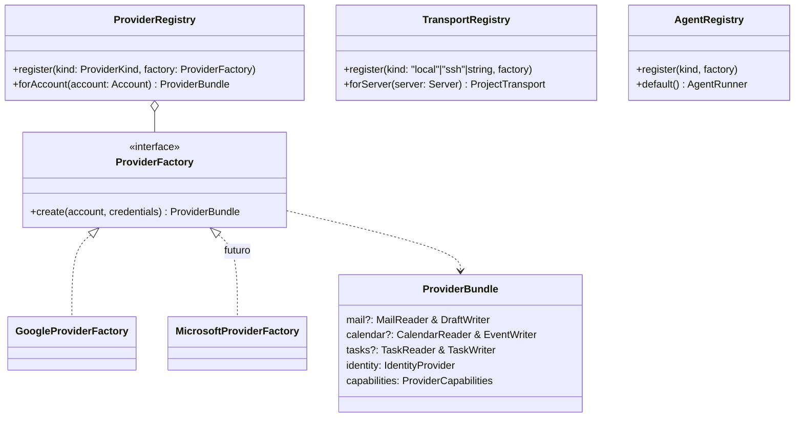
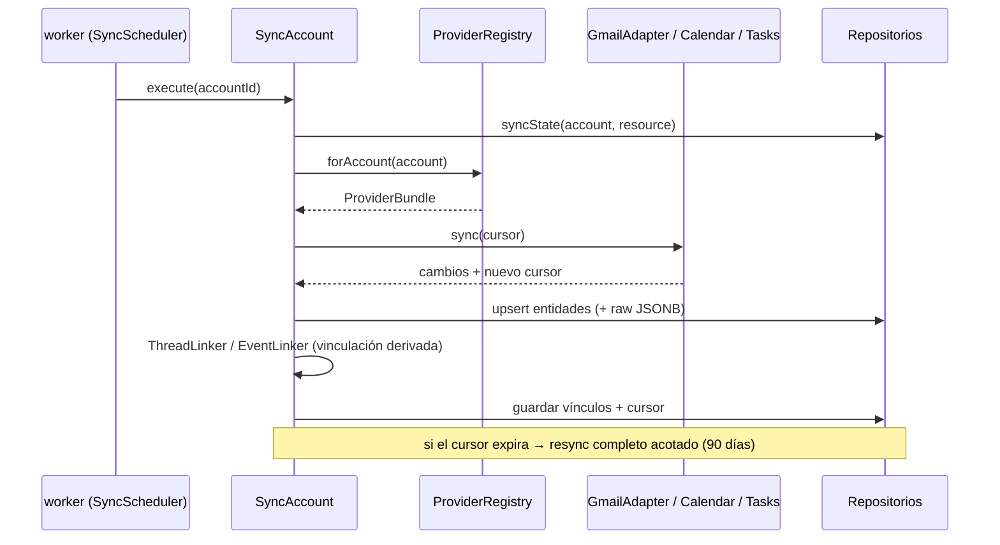
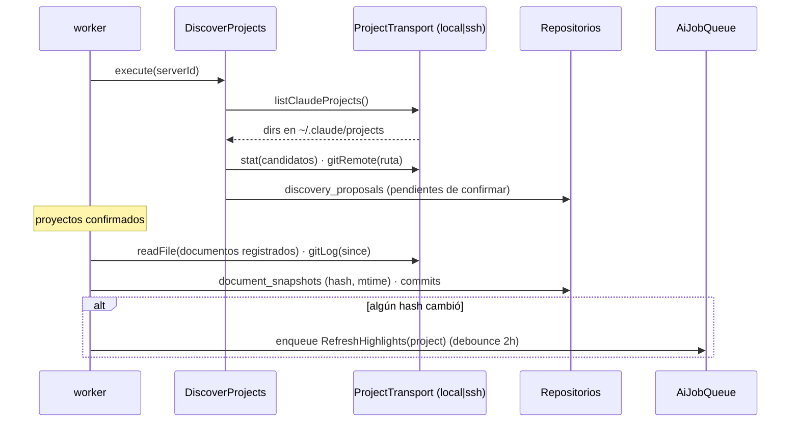
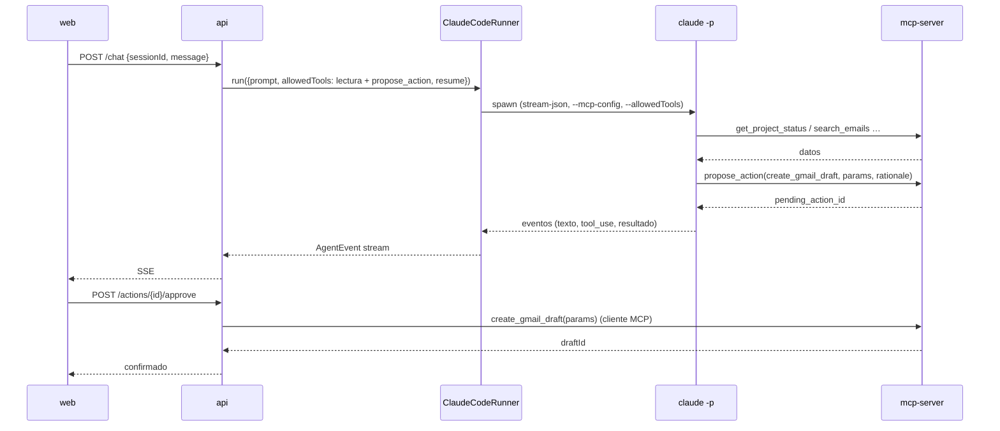
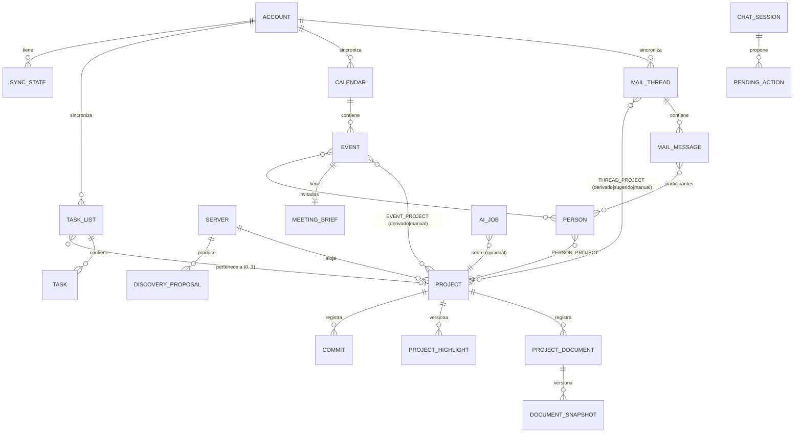

# Arquitectura de Jarvis

> Documento vivo. Describe **cómo está construido** Jarvis. El **por qué** y las decisiones de alcance están en
> [`superpowers/specs/2026-11-23-jarvis-design.md`](superpowers/specs/2026-11-23-jarvis-design.md).

## 1. Vista de contexto

Jarvis es un asistente personal que corre localmente en Docker. Integra proveedores de correo, calendario y tareas, lee el estado de proyectos de desarrollo en varios servidores y usa un agente de IA (Claude Code, con la suscripción del usuario) para resumir, responder preguntas y proponer acciones.



## 2. Contenedores (Docker Compose)



| Contenedor | Rol | Expone |
|---|---|---|
| `web` | Dashboard React. Sin lógica de negocio. | `127.0.0.1:3000` |
| `api` | Backend del dashboard: lectura/escritura vía **cliente MCP**, endpoints de administración (registro, vinculación, aprobaciones), orquestación del chat (`AgentRunner`), streaming SSE. | `127.0.0.1:3001` |
| `mcp-server` | **Única puerta de los agentes** a los datos y acciones. Herramientas del dominio sobre `core`. | `127.0.0.1:3002` (token bearer) |
| `worker` | Jobs: sincronización, descubrimiento de proyectos, snapshots, espejo de tareas, cola de IA. | — |
| `db` | Persistencia. | sólo red interna |

`api` y `worker` incluyen el CLI de Claude Code; el token de suscripción llega como Docker secret.

## 3. Capas y dependencias (puertos y adaptadores)

```mermaid
flowchart TB
  subgraph apps["apps/* (capa de entrega · NestJS)"]
    A1[api<br/>controllers · SSE]
    A2[mcp-server<br/>tools MCP]
    A3[worker<br/>jobs]
  end
  subgraph app["packages/core/application (casos de uso)"]
    UC[GetDailyBriefing · BlockFocusTime · CreateDraft<br/>SyncAccount · DiscoverProjects · RefreshHighlights<br/>LinkEntity · ProposeAction · ApproveAction …]
  end
  subgraph dom["packages/core/domain (TS puro)"]
    E[Entidades y value objects<br/>MailThread · CalendarEvent · Task · Project · Person · Account]
    S[Servicios de dominio<br/>FreeSlotFinder · ThreadLinker · EmailCleaner · PriorityRules]
    P[Puertos (interfaces)]
  end
  subgraph adapters["packages/adapters-* (infraestructura)"]
    AG[adapters-google]
    AT[adapters-transport<br/>local · ssh]
    AA[adapters-agent<br/>claude-code]
    AP[adapters-persistence<br/>drizzle/postgres]
  end
  apps --> app
  app --> dom
  adapters -- implementan --> P
  apps -. composición (DI) .-> adapters
```

**Regla de dependencias:** las flechas apuntan hacia adentro. `domain` no importa nada externo; `application` sólo importa `domain`; los adaptadores importan `domain` (para implementar puertos) y sus SDKs; las apps son la **raíz de composición** que conecta todo con la inyección de dependencias de NestJS. Una regla de lint (`eslint-plugin-boundaries` o `dependency-cruiser`) hace cumplir esto en CI.

## 4. Puertos principales



Además, un puerto de repositorio por agregado (`AccountRepository`, `ProjectRepository`, `MailRepository`, `EventRepository`, `TaskRepository`, `PersonRepository`, `HighlightRepository`, `PendingActionRepository`, `SyncStateRepository`), implementados con Drizzle.

### Registros y fábricas (O de SOLID)



Las diferencias entre proveedores se consultan por **capacidades** (`ProviderCapabilities`: `threads`, `replyHeaders`, `sendAsAliases`, `taskLists`, `freeBusy`…), nunca con `instanceof`.

## 5. Flujos clave

### 5.1 Sincronización de una cuenta



### 5.2 Descubrimiento y snapshot de proyectos



### 5.3 Chat con aprobación de acciones



### 5.4 Cola de IA en segundo plano

`AiJobQueue` (tabla en Postgres + procesador en `worker`): concurrencia 1, debounce por clave (`highlights:<project>`), tope diario configurable, ventana horaria para resúmenes de reunión (07:30) y recuperación de ejecuciones atrasadas al arrancar. Cada ejecución registra duración, motivo y resultado.

### 5.5 Espejo de tareas

`TaskChange` en una lista asociada a un proyecto → `MirrorTasks(project)` → render Markdown → `ProjectTransport.ensureGitExclude` + `writeJarvisFile(".jarvis/tasks.md")`.

## 6. Modelo de datos



Convenciones: IDs internos UUID; IDs externos como `(account_id, external_id)` únicos; columna `raw jsonb` con la respuesta original del proveedor; `created_at`/`updated_at` en todo; los vínculos guardan `origin` y `created_at` para analíticas históricas.

## 7. Estructura del repositorio

```
jarvis/
├─ apps/
│  ├─ api/            NestJS: módulos chat, actions, registry, links, read-models
│  ├─ mcp-server/     NestJS + MCP SDK: un provider por grupo de herramientas
│  ├─ worker/         NestJS + schedule: sync, discovery, snapshots, mirror, ai-queue
│  └─ web/            React + Vite
├─ packages/
│  ├─ core/
│  │  ├─ domain/       entidades, value objects, servicios, puertos
│  │  └─ application/  casos de uso
│  ├─ adapters-google/
│  ├─ adapters-transport/   local, ssh
│  ├─ adapters-agent/       claude-code
│  ├─ adapters-persistence/ drizzle (schema, migraciones, repositorios)
│  ├─ contracts/            tests de contrato por puerto (reutilizables por adaptadores)
│  └─ shared/               DTOs y esquemas Zod (api ↔ web ↔ mcp)
├─ agent/             instrucciones, skills y permisos del agente (versionados)
├─ remote/            jarvis-remote (forced command SSH) + instalador
├─ docker/            Dockerfiles
├─ docs/              arquitectura, specs, planes
├─ secrets/           (git-ignorado) OAuth, tokens, claves
├─ jarvis.config.example.yaml
└─ docker-compose.yml
```

## 8. Seguridad (resumen técnico)

| Riesgo | Mitigación |
|---|---|
| Envío de correos no deseado | No existe puerto ni herramienta de envío; scope `gmail.compose` sólo se usa para borradores. |
| Acciones del agente sin control | En el chat, sólo herramientas de lectura + `propose_action`; la ejecución real la dispara `api` tras aprobación. |
| Prompt injection desde correos/documentos | Contenido externo delimitado y marcado como no confiable; el agente no tiene Bash ni edición de archivos. |
| Ejecución arbitraria en servidores | `SshTransport` sólo con operaciones con nombre + `jarvis-remote` como forced command en `authorized_keys`. |
| Escritura indebida en repos | Sólo `writeJarvisFile` bajo `.jarvis/`; exclusión en `.git/info/exclude`; nunca commits. |
| Secretos | Docker secrets desde `secrets/` (git-ignorado); tokens OAuth 0600; nada sensible en logs. |
| Exposición de red | Puertos en `127.0.0.1`; MCP con token bearer. |

## 9. Cómo extender

**Nuevo proveedor (p. ej. Microsoft 365)**
1. Crear `packages/adapters-microsoft` con clases que implementen los puertos necesarios (`MailReader`, `DraftWriter`, …) y declaren sus `capabilities()`.
2. Implementar `MicrosoftProviderFactory` y `MicrosoftOAuthFlow`.
3. Hacer pasar la suite de `packages/contracts` para cada puerto.
4. Registrar la fábrica en `ProviderRegistry` (módulo Nest de proveedores). Dominio y casos de uso no cambian.

**Nuevo transporte** (p. ej. agente remoto por HTTP): implementar `ProjectTransport`, pasar contratos, registrar en `TransportRegistry`, agregar el `kind` al esquema de configuración.

**Nuevo agente**: implementar `AgentRunner` (streaming de `AgentEvent`, sesiones, herramientas MCP permitidas) y registrarlo en `AgentRegistry`. `AgentSummarizer` funciona sobre cualquier `AgentRunner`.
