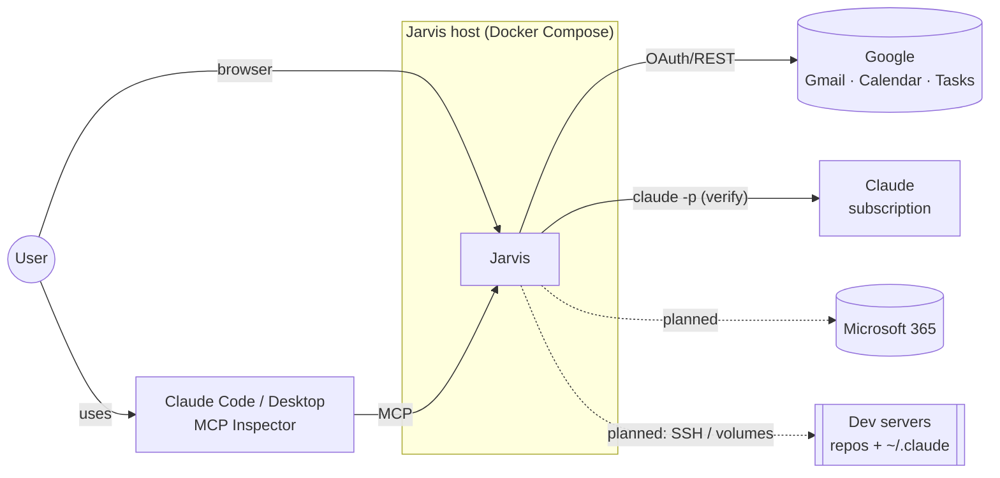
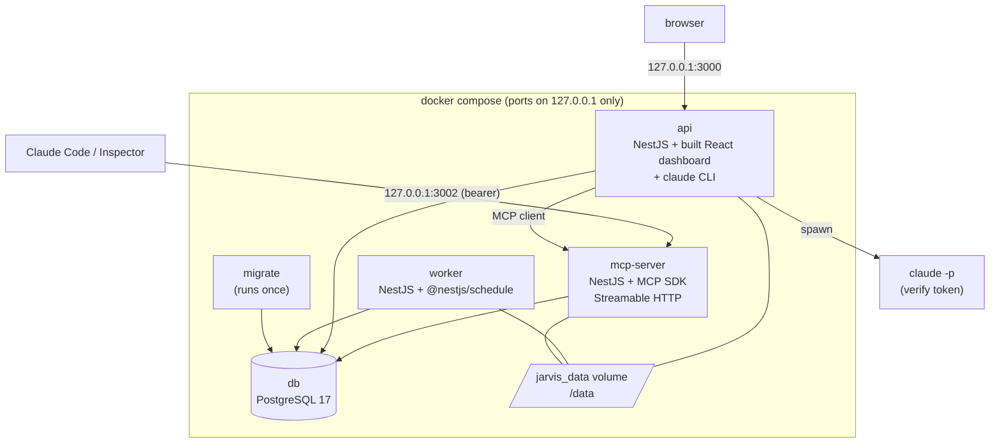
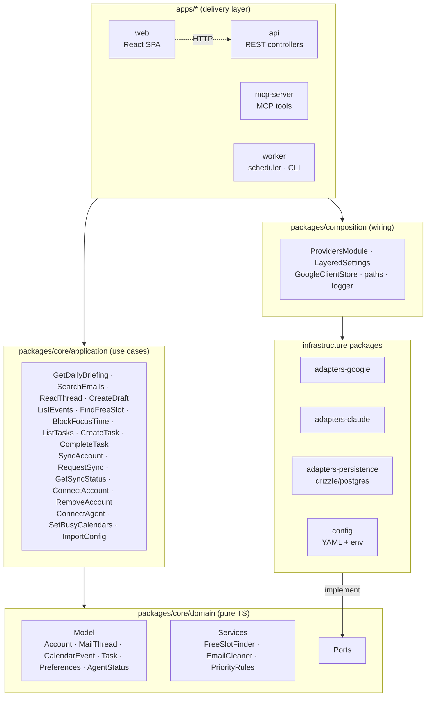
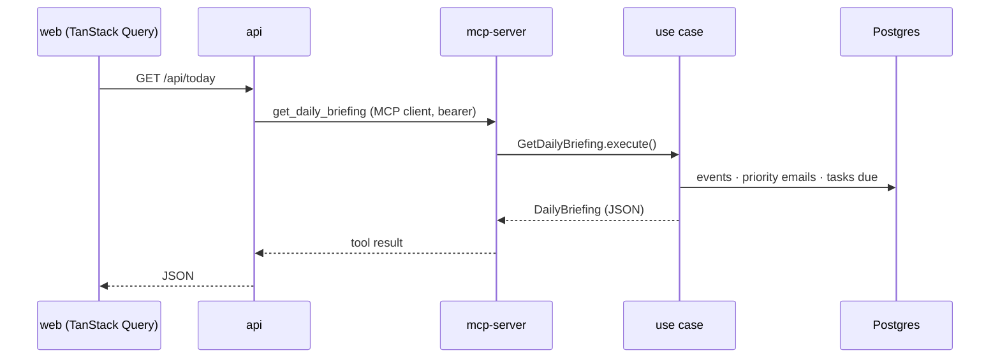
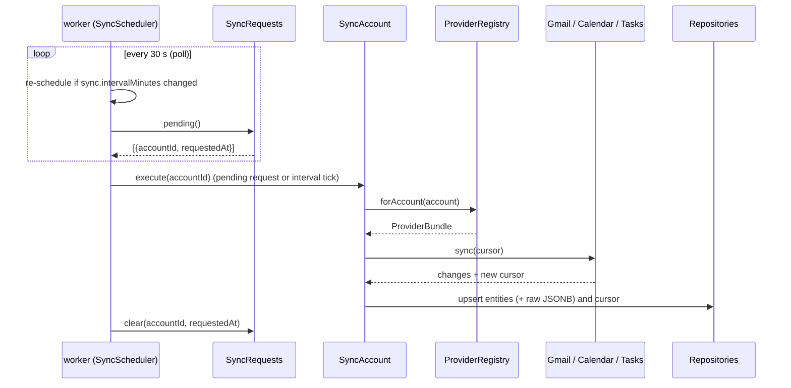
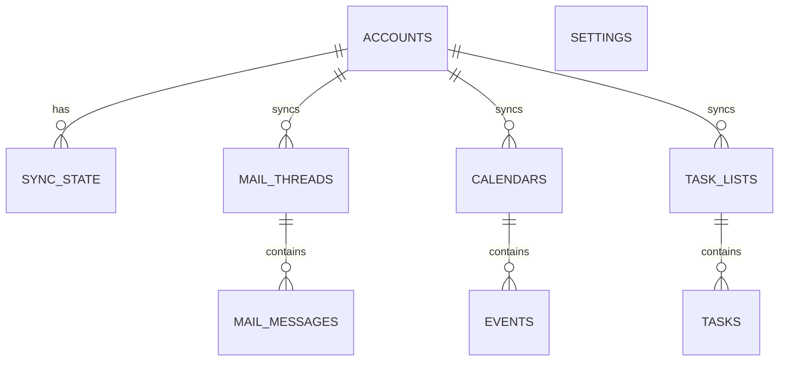

# Jarvis Architecture

> Living document. It describes **how Jarvis is built today** (phases 1 and 4a: Google sync, MCP server, dashboard
> and onboarding). Parts of the design that are not built yet are grouped in §10, *Planned*. The **why** and the
> scope decisions are in [`superpowers/specs/2026-11-23-jarvis-design.md`](superpowers/specs/2026-11-23-jarvis-design.md)
> and [`superpowers/specs/2026-11-24-jarvis-dashboard-onboarding-design.md`](superpowers/specs/2026-11-24-jarvis-dashboard-onboarding-design.md).

## 1. Context view

Jarvis is a personal assistant that runs locally in Docker. Today it syncs Gmail, Google Calendar and Google Tasks,
shows them in a local dashboard and exposes them to Claude through an MCP server. The Claude subscription token is
verified with the Claude Code CLI; the chat agent comes in phase 3. Dashed arrows are planned.



## 2. Containers (Docker Compose)

Started by `./jarvis start`; only `api` and `mcp-server` publish ports, both on `127.0.0.1`.



| Container | Role | Exposes |
|---|---|---|
| `api` | Serves the built dashboard and `/api/*` (§6). User data goes through an **MCP client** to `mcp-server`; installation state (setup status, accounts, OAuth, settings, agent) through application services. Ships the pinned Claude Code CLI to verify the subscription token. | `127.0.0.1:3000` |
| `mcp-server` | **The only gateway** to user data and actions: domain tools on top of `core`. | `127.0.0.1:3002` (bearer token) |
| `worker` | Sync scheduler; reads settings and active accounts at runtime. | none |
| `migrate` | Applies the database migrations and exits; `api`, `worker` and `mcp-server` wait for it. | none |
| `db` | PostgreSQL 17 (`pgdata` volume). | internal network only |

Volumes: `pgdata` (database) and `jarvis_data` mounted at `/data` in `api`, `worker` and `mcp-server`
(`tokens/`, `google/oauth-client.json`, `agent/claude-token`, all mode `0600`; pre-created owned by uid 1000, the
`node` user). Docker secrets from `./secrets`: `pg_password` (all services) and `mcp_token` (`api`, `mcp-server`).
The YAML config and the legacy `google_oauth_client` secret are optional and not part of the default compose file
(see the README, "Advanced").

## 3. Layers and dependencies (ports and adapters)



**Dependency rule:** arrows point inwards. `domain` imports nothing external; `application` only imports `domain`;
adapters import `domain` (to implement ports) and their SDKs; `composition` and the apps are the composition root that
wires everything with NestJS dependency injection. `web` only talks to `api` over HTTP. `dependency-cruiser`
(`pnpm lint:deps`) enforces the rules.

## 4. Ports and adapters

| Port (`packages/core/src/domain/ports`) | Implemented by |
|---|---|
| `MailReader`, `DraftWriter`, `IdentityProvider` | `adapters-google` (Gmail) |
| `CalendarReader`, `EventWriter` | `adapters-google` (Calendar) |
| `TaskReader`, `TaskWriter` | `adapters-google` (Tasks) |
| `AccountConnector` (OAuth start/complete) | `adapters-google` (OAuth) |
| `ProviderFactory` → `ProviderBundle` | `GoogleProviderFactory` |
| `AgentRunner`, `AgentCredentialStore`, `AgentStatusStore` | `adapters-claude` (`ClaudeCliRunner`, file stores under `/data/agent`) |
| `AccountRepository`, `SyncStateRepository`, `MailRepository`, `EventRepository`, `TaskRepository`, `PersonLinkLookup`, `SettingsStore`, `SyncRequests` | `adapters-persistence` (Drizzle) |
| `Clock` | `composition` (`SystemClock`) |

`ProviderBundle` groups what one account offers (`mail?`, `calendar?`, `tasks?`, `identity`, `capabilities`).
Provider differences are queried through `ProviderCapabilities`, never with `instanceof`.

**`ProviderRegistry`** (application) maps a `ProviderKind` to its factory and caches one bundle per account. A factory
may expose `fingerprint(account)`; when it changes the registry rebuilds the bundle. `GoogleProviderFactory`'s
fingerprint is the stored token plus the user's **current** time zone, read from a live source, so a reconnect or a
time-zone change in Settings is picked up by `worker` and `mcp-server` without a restart.

**Settings** are layered (`LayeredSettings`): database > YAML > defaults. Every reader (`worker` tick, MCP tools,
`api`) asks for the current value, so dashboard changes apply without restarts.

## 5. Key flows

### 5.1 Reading data from the dashboard



The dashboard never reads user data from the database directly: the same MCP tools an agent uses back every view, so
the agent and the UI see the same thing. Write actions (draft, task, focus block) follow the same path with the
corresponding tool. Only installation state (setup status, accounts, OAuth, preferences, agent token) uses
application services directly in `api`.

### 5.2 Syncing an account



- The interval comes from the settings; on start the worker catches up right away when the last sync is overdue.
- A sync request is a timestamp on the account (`accounts.sync_requested_at`). `clear` is compare-and-clear: a request
  made while the account was syncing stays pending.
- Requests come from the *Sync now* button (`POST /api/sync` → `trigger_sync`) and from the OAuth callback right after
  an account is connected (best effort), so the first sync starts without waiting for the interval.
- When a cursor expires the sync falls back to a bounded full resync (90 days of mail by default).

### 5.3 Connecting a Google account

`GET /api/oauth/google/start` → `ConnectAccount` creates the auth URL and keeps the state in memory (`oauth-pending`)
→ Google → `GET /api/oauth/google/callback` checks the state, stores the token in `/data/tokens` (0600), creates or
re-activates the account, requests a sync and redirects to the wizard or Settings with `?connected=` or `?error=`.

### 5.4 Verifying the Claude token

`PUT /api/agent/token` rejects API-key-shaped values, stores the token in `/data/agent/claude-token` (0600), and
`POST /api/agent/verify` runs `claude -p "Reply with OK" --output-format json` with only `PATH`, `HOME`, `TMPDIR` and
the token in its environment. The result (ok + latency, or a capped failure message) is saved in `AgentStatusStore`.

## 6. API and dashboard

### `/api` endpoints (`apps/api`)

| Group | Endpoints |
|---|---|
| Setup | `GET /api/setup/status`, `GET /api/providers`, `GET /api/health` |
| Google client | `GET`/`PUT /api/google/client` |
| OAuth | `GET /api/oauth/:kind/start`, `GET /api/oauth/:kind/callback` |
| Accounts | `GET /api/accounts`, `DELETE /api/accounts/:id?deleteData=`, `PUT /api/accounts/:id/calendars` |
| Settings | `GET`/`PUT /api/settings` |
| Agent | `PUT /api/agent/token`, `POST /api/agent/verify`, `POST /api/agent/skip` |
| Today | `GET /api/today` |
| Mail | `GET /api/mail/search`, `GET /api/mail/threads/:accountId/:threadId`, `POST /api/mail/drafts` |
| Calendar | `GET /api/calendar/events`, `GET /api/calendar/calendars`, `POST /api/calendar/free-slot`, `POST /api/calendar/focus` |
| Tasks | `GET /api/tasks`, `GET /api/tasks/lists`, `POST /api/tasks`, `POST /api/tasks/:accountId/:taskId/complete` |
| Sync | `GET /api/sync`, `POST /api/sync` |

`LocalOnlyGuard` rejects any `Host`/`Origin` other than `127.0.0.1:3000`/`localhost:3000`, and every non-GET request
must carry a JSON body (a CSRF defence: a cross-site form cannot send `application/json`).

### Dashboard (`apps/web`)

React 19 + Vite + React Router 7 + TanStack Query + Tailwind (shadcn-style components). Built into `api` and served
from the same origin.

| Route | What it shows |
|---|---|
| `/onboarding/{mail,agent,preferences,done}` | Wizard: Google client + connect, Claude token (optional), preferences, finish. `RequireSetup` sends you here until an account exists and preferences are saved. |
| `/` (Today) | Agenda for the day with free slots and *Block focus*, priority emails, tasks due, free minutes. |
| `/mail`, `/mail/:accountId/:threadId` | Search, thread view (external content rendered as untrusted text), reply as a **draft**. |
| `/calendar` | Events, *Find free slot*, focus block with an account selector. |
| `/tasks` | Lists and tasks per account, create and complete. |
| `/settings/{accounts,agent,preferences}` | Connect, reconnect or remove accounts (optionally deleting their data), busy calendars, agent token, preferences. |

The shell shows a sync indicator (*Sync now*) and a re-authorization banner for accounts whose token was revoked.
Every action that touches more than one account asks which account to use instead of guessing.

## 7. Data model



Conventions: `accounts.id` is the account slug (e.g. `personal`), not a UUID; external IDs are unique as
`(account_id, external_id)`; a `raw jsonb` column keeps the provider's original response; `settings` holds the single
preferences document. Secrets (OAuth tokens, Google client, Claude token) live in files under `/data`, never in the
database.

## 8. Repository layout

```
jarvis/
├─ apps/
│  ├─ api/          NestJS: REST controllers, LocalOnlyGuard, MCP client, OAuth, e2e smoke server
│  ├─ mcp-server/   NestJS + MCP SDK: tool groups (briefing, email, calendar, tasks, sync), bearer guard
│  ├─ worker/       NestJS + schedule: SyncScheduler, catch-up, config import; CLI (`jarvis auth`)
│  └─ web/          React + Vite dashboard and onboarding; Playwright e2e in `e2e/`
├─ packages/
│  ├─ core/                 domain (model, services, ports) and application (use cases, registry, views)
│  ├─ adapters-google/      Gmail, Calendar, Tasks, OAuth, GoogleProviderFactory
│  ├─ adapters-claude/      ClaudeCliRunner and agent credential/status stores
│  ├─ adapters-persistence/ Drizzle schema, migrations, repositories
│  ├─ composition/          Nest providers module, layered settings, paths, logger, Google client store
│  ├─ config/               YAML + env loading and schema
│  └─ contracts/            reusable per-port contract tests
├─ docker/          Dockerfiles
├─ docs/            architecture, pending work, specs, plans, spikes
├─ tests/           repo-level tests (the `jarvis` script)
├─ secrets/         (git-ignored) mcp_token, pg_password
├─ jarvis           start/stop/status/logs script
├─ jarvis.config.example.yaml
└─ docker-compose.yml
```

## 9. Security (technical summary)

| Risk | Mitigation |
|---|---|
| Unwanted email sending | No send port, tool or endpoint; the `gmail.compose` scope is only used for drafts. |
| API-key billing | Only a subscription token from `claude setup-token` is accepted; API-key-shaped values are rejected. |
| Cross-site requests to the local dashboard | `LocalOnlyGuard` (Host/Origin allow-list) + JSON-only bodies on writes. |
| Prompt injection / XSS from emails | External content is delimited and marked untrusted in MCP output; the dashboard renders it as text. |
| Secrets | Docker secrets from `secrets/` (git-ignored); files under `/data` mode `0600`; tokens never logged; CLI failure text capped at 500 characters. |
| Network exposure | Ports on `127.0.0.1` only; MCP requires a bearer token. |

## 10. Planned (not built yet)

These parts of the original design are not implemented; see [`PENDING.md`](PENDING.md) for the backlog.

- **Phase 3: agent chat.** A chat panel in the dashboard backed by `claude -p` streaming (SSE), with read-only MCP
  tools plus `propose_action`; actions run only after the user approves them in the UI (`PendingAction`).
- **Phase 2: projects.** `ProjectTransport` (local volumes and restricted SSH with a `jarvis-remote` forced command),
  project discovery from `~/.claude/projects`, document snapshots and commits, AI highlights through a background
  queue, linking of threads/events/people to projects, and a task mirror written to `.jarvis/tasks.md`.
- **More providers**, e.g. Microsoft 365: a new `adapters-*` package implementing the same ports and a
  `ProviderFactory`, passing the `contracts` suite and registered in `ProvidersModule`. Domain and use cases do not
  change.
- **Analytics** over the synced history.
